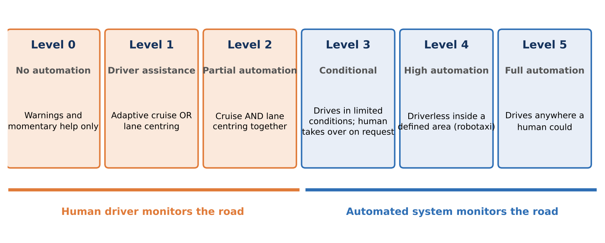
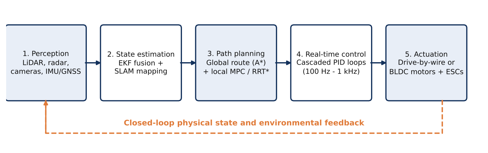
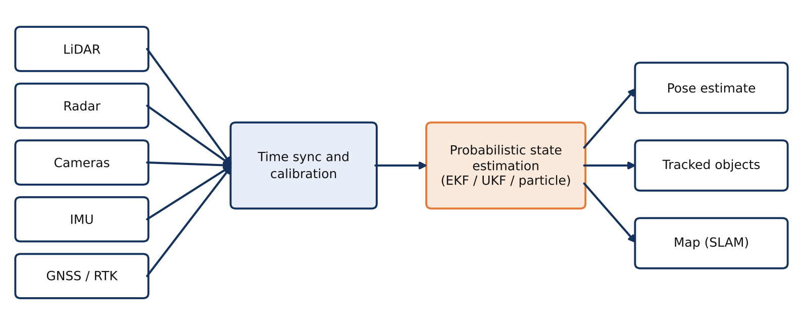
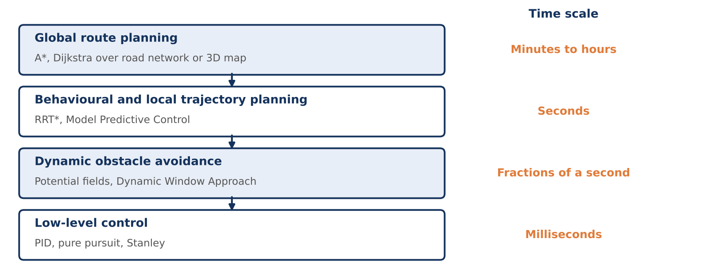
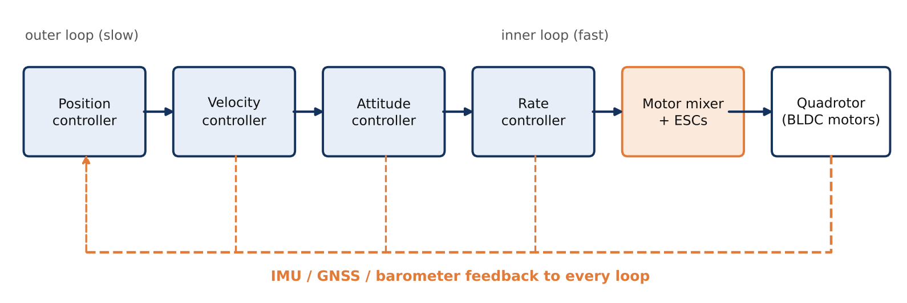
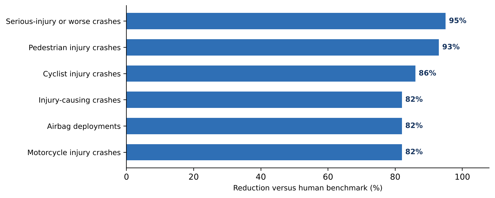
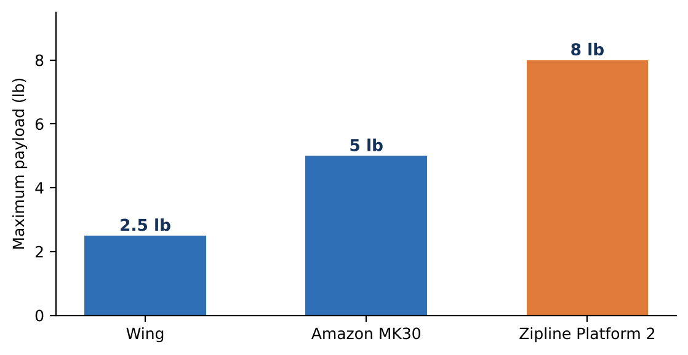

# Robotics Applications in Autonomous Vehicles and Unmanned Aerial Vehicles

**A research report for the CodeAlpha Robotics & Automation Internship (Task 1)**

| | |
|---|---|
| **Intern** | Mohamed Essam Refaat |
| **Intern ID** | CA/DF1/440462 |
| **Domain** | Robotics & Automation |
| **Submission date** | 21 November 2026 |

---

## Table of Contents

1. [Overview](#overview)
2. [Why Ground Vehicles and Drones Together?](#why-ground-vehicles-and-drones-together)
3. [Levels of Driving Automation (SAE J3016)](#levels-of-driving-automation-sae-j3016)
4. [The Sense-Plan-Act Loop](#the-sense-plan-act-loop)
5. [Multi-Sensor Perception](#multi-sensor-perception)
6. [Sensor Fusion and SLAM](#sensor-fusion-and-slam)
7. [Navigation, Path Planning and Control](#navigation-path-planning-and-control)
8. [Applications and Current Deployments](#applications-and-current-deployments)
9. [Ground Vehicles vs. Drones](#ground-vehicles-vs-drones)
10. [Challenges](#challenges)
11. [Future Trends](#future-trends)
12. [Conclusion](#conclusion)
13. [Repository Structure](#repository-structure)
14. [References](#references)

---

## Overview

Autonomous ground vehicles (AVs) and unmanned aerial vehicles (UAVs, or drones) are among the most visible results of recent progress in embedded systems, multi-sensor perception and artificial intelligence. Both are **mobile cyber-physical systems**: they perceive a changing environment, compute collision-free trajectories and run closed-loop control with little or no continuous human intervention.

This report covers:

- **Architecture:** multimodal sensor fusion, simultaneous localization and mapping (SLAM), hierarchical motion planning, and real-time chassis and flight control.
- **Deployments:** current commercial services, using recent operator data (Waymo robotaxis, delivery drones, agricultural drones).
- **Comparison:** how ground and aerial platforms differ in degrees of freedom, compute, endurance and risk.
- **Challenges:** technical, cybersecurity, regulatory and ethical issues that shape what comes next.

---

## Why Ground Vehicles and Drones Together?

The two platforms move very differently:

- **Ground vehicles** use wheeled kinematics and navigate road networks governed by traffic rules and pedestrian interaction.
- **Drones** (multi-rotor or fixed-wing) move with **six degrees of freedom (6-DOF)** in three-dimensional airspace and are limited by aerodynamics and strict payload budgets [1].

Despite this, both share one software and hardware paradigm: a **continuous sense-plan-act loop** that converts raw physical measurements into safe, energy-efficient motion. That shared structure is what the rest of the report follows.

---

## Levels of Driving Automation (SAE J3016)

SAE International's J3016 standard defines six levels of driving automation, from Level 0 (no automation) to Level 5 (full automation in all operational design domains) [2].



*Figure 1: SAE J3016 levels of driving automation (summarised from [2]).*

| Level | Name | What it means |
|---|---|---|
| 0 | No automation | Warnings and momentary help only |
| 1 | Driver assistance | Adaptive cruise control **or** lane centring |
| 2 | Partial automation | Cruise **and** lane centring together |
| 3 | Conditional automation | Drives in limited conditions; human takes over on request |
| 4 | High automation | Driverless inside a defined area (for example, a robotaxi) |
| 5 | Full automation | Drives anywhere a human could |

At Levels 0 to 2 the **human driver monitors the road**. At Levels 3 to 5 the **automated system monitors the road**.

Most modern consumer vehicles sit at Levels 1 and 2 (ADAS features such as adaptive cruise control and lane keeping). Level 4 robotaxis, and delivery drones in a comparable role, aim to remove human supervision entirely **within defined geographic boundaries**. They rely on redundant perception, real-time operating systems (RTOS) and fail-operational actuation.

> **Note:** J3016 formally applies to on-road motor vehicles. Drones are not covered by it, so the comparison here is a conceptual one.

---

## The Sense-Plan-Act Loop



*Figure 2: End-to-end sense-plan-act control flow for autonomous ground and aerial robots.*

| Stage | Role | Typical technology |
|---|---|---|
| 1. Perception | Measure the world | LiDAR, radar, cameras, IMU/GNSS |
| 2. State estimation | Combine measurements into pose and map | EKF fusion, SLAM mapping |
| 3. Path planning | Decide where to go | Global route (A*), local MPC / RRT* |
| 4. Real-time control | Turn plans into commands | Cascaded PID loops (100 Hz to 1 kHz) |
| 5. Actuation | Move the vehicle | Drive-by-wire, or BLDC motors with ESCs |

The loop is **closed**: the physical state of the vehicle and the environment feed back into perception on every cycle.

---

## Multi-Sensor Perception

No single sensor performs best across all lighting, weather and range conditions. Modern platforms therefore combine different sensors and fuse their outputs into one real-time model of the surroundings [3].

### Exteroceptive and proprioceptive sensors

*Exteroceptive* sensors measure the external environment. *Proprioceptive* sensors monitor the platform's own internal state.

- **LiDAR (Light Detection and Ranging):** emits pulsed laser beams to produce high-resolution 3D point clouds. It gives accurate depth and object geometry independent of ambient light, which suits obstacle detection and high-definition mapping.
- **Radar:** uses millimeter-wave radio signals to measure relative distance and velocity through the Doppler effect. It keeps working in rain, fog and dust.
- **Cameras:** monocular, stereo and RGB-D cameras capture the semantic and colour information needed to read signs, find lane markings, classify pedestrians and perform visual odometry on weight-constrained drones.
- **Ultrasonic sensors:** short-range transducers used for parking assistance, low-altitude estimation and indoor proximity detection.
- **IMU and GNSS:** inertial measurement units measure acceleration and angular velocity at a high rate, while GNSS/RTK provides global position.

### Sensor comparison

| Sensor | Primary measurements | Key strengths | Operational limitations |
|---|---|---|---|
| **LiDAR** | 3D point clouds, exact range, object shape | High spatial accuracy; works in total darkness | High cost; degraded by heavy rain, snow or dense fog |
| **mmWave radar** | Distance, relative velocity, angle | Weather-robust; long detection range | Low angular resolution; poor object classification |
| **RGB / stereo cameras** | Colour, texture, semantic features, stereo depth | Low cost and weight; excels at classification | Sensitive to glare, low light and weather occlusion |
| **IMU + RTK-GNSS** | Orientation, acceleration, global coordinates | High update rate (IMU); centimetre-level accuracy (RTK) | IMU drift over time; GNSS multipath or loss indoors |

---

## Sensor Fusion and SLAM

### Probabilistic state estimation

Data from asynchronous sensors is time-synchronized, calibrated and merged with probabilistic estimators such as the **Extended Kalman Filter (EKF)**, the **Unscented Kalman Filter (UKF)** and **particle filters** [4]. Combining high-rate IMU data with slower GNSS or visual updates lets the controller keep an accurate pose estimate (position and orientation) even during short sensor dropouts.



*Figure 3: Multi-sensor fusion architecture producing pose, tracked objects and a map.*

### SLAM in GPS-denied environments

In urban canyons, indoor warehouses and tunnels, GNSS is unreliable. Vehicles and drones then rely on **Simultaneous Localization and Mapping (SLAM)**:

- **Visual-inertial odometry (VIO)** and **LiDAR-SLAM** extract landmarks to build a map while localizing the robot inside it [5].
- **Loop-closure detection** recognizes previously visited places and removes accumulated drift.

---

## Navigation, Path Planning and Control

Once the platform knows its pose and sees nearby obstacles, planning and control modules turn mission goals into actuator signals.

### Hierarchical motion planning



*Figure 4: Hierarchical motion planning layers and their time scales.*

| Layer | What it does | Methods | Time scale |
|---|---|---|---|
| Global route planning | Computes a macro-level path over road networks or 3D elevation maps | A*, Dijkstra | Minutes to hours |
| Behavioural and local trajectory planning | Generates dynamically feasible, collision-free trajectories in real time | RRT*, Model Predictive Control (MPC) [6] | Seconds |
| Dynamic obstacle avoidance | Reactive manoeuvres when an unexpected hazard enters the safety envelope | Artificial potential fields, Dynamic Window Approach (DWA) | Fractions of a second |
| Low-level control | Tracks the planned trajectory | PID, pure pursuit, Stanley | Milliseconds |

### Embedded control and actuation

At the lowest layer, microcontrollers and companion computers run deterministic control loops at roughly **100 Hz to 1 kHz**.

- **Ground vehicles:** drive-by-wire interfaces replace mechanical linkages with electronic throttle, brake and steering actuators. Lateral control uses **pure pursuit** or **Stanley** controllers, and longitudinal control uses **PID**.
- **Multi-rotor drones:** flight controllers use **cascaded PID loops**. Outer loops regulate position and velocity. A fast inner attitude loop adjusts individual brushless DC (BLDC) motor speeds through Electronic Speed Controllers (ESCs) to stabilize roll, pitch and yaw against wind disturbances [7].



*Figure 5: Cascaded control architecture of a multi-rotor drone.*

---

## Applications and Current Deployments

### Application areas

| Area | How autonomy is used |
|---|---|
| **Transportation and last-mile logistics** | Autonomous shuttles and trucks reduce congestion and fatigue-related errors; delivery drones bypass road bottlenecks to carry medical supplies and parcels |
| **Precision agriculture** | Camera-equipped drones monitor crop health indices such as NDVI and guide variable-rate sprayers |
| **Inspection and rescue** | Drones with thermal imaging and LiDAR inspect power lines, wind turbines and bridges without scaffolding, and can locate survivors where wheeled vehicles cannot reach |

### Robotaxis: Waymo as a Level 4 example

Waymo, owned by Alphabet, operates fully driverless paid rides.

- By **March 2026** it reported about **500,000 paid rides per week** across **ten US cities**, ten times its May 2024 level [9].
- Its own analysis of **271.3 million rider-only miles through June 2026** in five metropolitan areas reports **82% fewer injury-causing crashes** and **95% fewer serious-injury-or-worse crashes** than a human benchmark for the same areas [10].



*Figure 6: Crash reductions reported by Waymo versus human benchmarks (company data [10]).*

| Crash category | Reduction vs. human benchmark |
|---|---|
| Serious-injury or worse crashes | 95% |
| Pedestrian injury crashes | 93% |
| Cyclist injury crashes | 86% |
| Injury-causing crashes | 82% |
| Airbag deployments | 82% |
| Motorcycle injury crashes | 82% |

> **Caution:** these figures are published by the operator and cover limited cities and conditions, so independent verification remains important.

### Delivery and agricultural drones

- **Amazon** announced in August 2026 that Prime Air would expand to nearly **500 US cities and towns** by the end of the year.
- **Uber and Zipline** set a target of **one million drone deliveries per day by 2029** [11].
- **Walmart** reports an average of roughly **23 minutes** from order to drop [12].
- **DJI** estimates that about **600,000** of its agricultural spraying drones are used in more than 100 countries (manufacturer figure) [13].

Payload remains the limiting factor for delivery drones:



*Figure 7: Maximum payload of commercial delivery drones [12].*

| Drone | Maximum payload |
|---|---|
| Wing | 2.5 lb |
| Amazon MK30 | 5 lb |
| Zipline Platform 2 | 8 lb |

---

## Ground Vehicles vs. Drones

| Design parameter | Autonomous ground vehicles | Drones (UAVs) |
|---|---|---|
| **Degrees of freedom** | 3-DOF planar motion (x, y, yaw) with nonholonomic steering constraints | 6-DOF spatial motion; quadrotors are underactuated |
| **Payload and compute** | High payload; supports multi-GPU computers and full LiDAR arrays | Strict size, weight and power (SWaP) limits; relies on edge AI accelerators [8] |
| **Endurance and energy** | Large battery packs; multi-hour operation | Limited flight endurance, typically 20-45 minutes for multi-rotors |
| **Primary safety risk** | High-speed collisions in dense traffic and pedestrian zones | Loss of lift or propulsion, airspace conflicts, battery depletion |

---

## Challenges

Level 4/5 vehicles and beyond-visual-line-of-sight (BVLOS) drones still face persistent hurdles.

### Technical

- **Edge cases:** erratic human drivers, construction zones and severe weather continue to challenge deep neural network perception, which can suffer from **domain shift** and **adversarial vulnerability** [3].
- **Compute budgets:** onboard inference must balance throughput against strict thermal and power limits, especially on battery-powered drones.

### Cybersecurity

GNSS spoofing or interception of Vehicle-to-Everything (V2X) links poses serious safety risks. Mitigations include hardware-level authentication and intrusion detection.

### Regulatory and ethical

- The FAA's final **Part 108** rule would allow routine BVLOS flights without individual waivers. It was sent for White House review on **10 July 2026** and had **no announced publication date as of 17 November 2026**. Until then, operators rely on existing waivers and exemptions [14].
- Open questions remain around **privacy** (cameras and LiDAR recording public space), **noise complaints**, and **liability** when no human is driving.

---

## Future Trends

- **Cooperative air-ground robotic teams:** drones act as aerial scouts that provide overhead maps to ground vehicles.
- **Neuromorphic vision sensors** for fast, low-power perception.
- **End-to-end foundation models** that unify perception and motion planning.
- **Standardized BVLOS rules and UAS traffic management (UTM)** services to support denser low-altitude traffic [14].

---

## Conclusion

Autonomous vehicles and drones combine mechanical engineering, embedded control, sensor fusion and artificial intelligence. By merging complementary perception modalities through probabilistic estimation and running hierarchical planners on real-time hardware, these platforms achieve high autonomy, and commercial services now operate at scale in some regions.

Adverse-weather robustness, edge-compute efficiency, cybersecurity, independent safety evidence and timely certification remain active challenges. Cooperative robotics and fail-safe architectures will continue to widen their impact on transportation, industry and public safety.

---

## Repository Structure

```
.
├── README.md
├── CodeAlpha_Task1_Research_Report_Final.pdf   # full report
└── images/
    ├── fig1_sae_levels.png
    ├── fig2_sense_plan_act.png
    ├── fig3_sensor_fusion.png
    ├── fig4_motion_planning.png
    ├── fig5_drone_control.png
    ├── fig6_waymo_safety.png
    └── fig7_drone_payload.png
```

The full report is available as a PDF: [CodeAlpha_Task1_Research_Report_Final.pdf](CodeAlpha_Task1_Research_Report_Final.pdf).

---

## References

1. B. Siciliano and O. Khatib, Eds., *Springer Handbook of Robotics*, 2nd ed. Cham, Switzerland: Springer, 2016.
2. SAE International, "Taxonomy and definitions for terms related to driving automation systems for on-road motor vehicles," Standard J3016_202104, Apr. 2021. doi: 10.4271/J3016_202104.
3. E. Yurtsever, J. Lambert, A. Carballo, and K. Takeda, "A survey of autonomous driving: Common practices and emerging technologies," *IEEE Access*, vol. 8, pp. 58443-58469, 2020.
4. S. Thrun, W. Burgard, and D. Fox, *Probabilistic Robotics*. Cambridge, MA, USA: MIT Press, 2005.
5. C. Cadena et al., "Past, present, and future of simultaneous localization and mapping: Toward the robust-perception age," *IEEE Trans. Robotics*, vol. 32, no. 6, pp. 1309-1332, Dec. 2016.
6. B. Paden, M. Cap, S. Z. Yong, D. Yershov, and E. Frazzoli, "A survey of motion planning and control techniques for self-driving urban vehicles," *IEEE Trans. Intelligent Vehicles*, vol. 1, no. 1, pp. 33-55, Mar. 2016.
7. R. Mahony, V. Kumar, and P. Corke, "Multirotor aerial vehicles: Modeling, estimation, and control of quadrotor," *IEEE Robotics & Automation Mag.*, vol. 19, no. 3, pp. 20-32, Sep. 2012.
8. D. Floreano and R. J. Wood, "Science, technology and the future of small autonomous drones," *Nature*, vol. 521, no. 7553, pp. 460-466, May 2015.
9. TechCrunch, "Waymo's skyrocketing ridership in one chart," 27 Mar. 2026. [Link](https://techcrunch.com/2026/03/27/waymo-skyrocketing-ridership-in-one-chart/)
10. Waymo, "From the road: Safety data, September 24, 2026," 24 Sep. 2026. [Link](https://waymo.com/blog/shorts/safetydata-september26/)
11. Fortune, "Amazon, Uber, DoorDash and Walmart race to scale drone delivery," 21 Aug. 2026. [Link](https://fortune.com/2026/08/21/amazon-uber-doordash-walmart-drone-delivery-wars/)
12. DroneXL, "Delivery by drone," updated Aug. 2026. [Link](https://dronexl.co/uk/delivery-by-drone/)
13. DJI Agriculture, "Global adoption of agricultural drones," press release, 29 Apr. 2026. [Link](https://www.dji.com/media-center/announcements/dji-global-adoption-51mt-saves-410mts-farmers)
14. UAV Coach, "FAA reports 2.2 million UTM flights, but Part 108 still has no release date," 17 Nov. 2026. [Link](https://uavcoach.com/faa-utm-flights-part-108-update/)

---

## Author

**Mohamed Essam Refaat**, Robotics & Automation Intern at CodeAlpha (ID: CA/DF1/440462)
