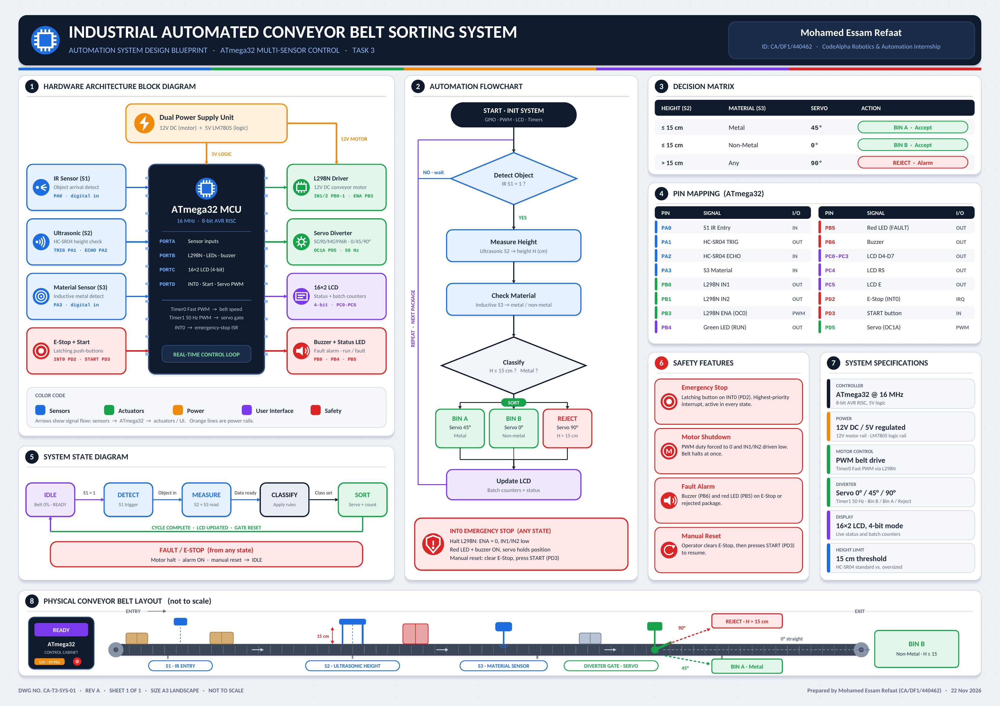
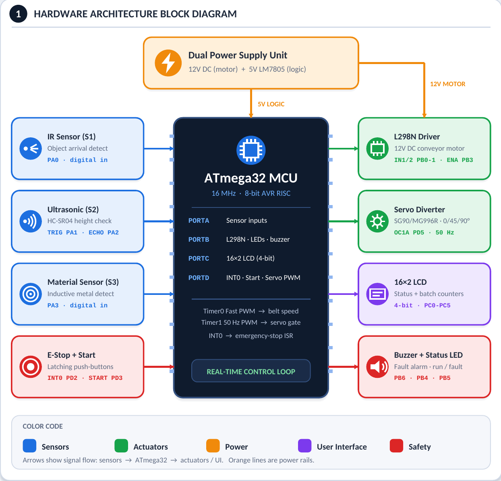
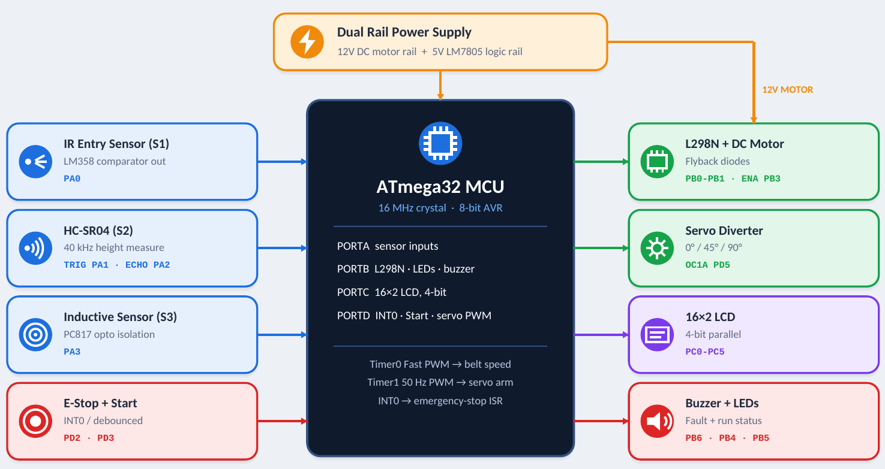
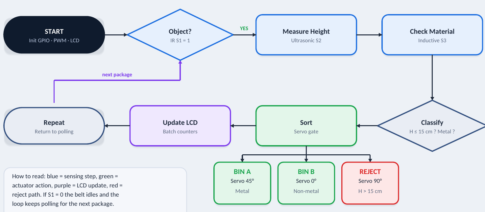
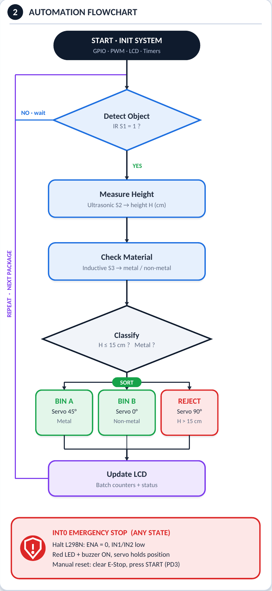
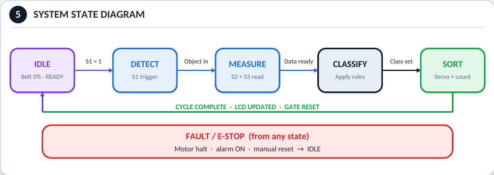
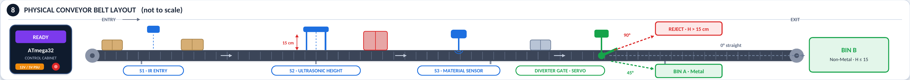

# Industrial Automated Conveyor Belt Sorting System

**ATmega32 multi-sensor automation system design (CodeAlpha Robotics & Automation Internship, Task 3)**

| | |
|---|---|
| **Intern** | Mohamed Essam Refaat |
| **Intern ID** | CA/DF1/440462 |
| **Drawing No.** | CA-T3-SYS-01 (Rev A, Sheet 1 of 1, A3 landscape) |
| **Date** | 22 November 2026 |
| **Controller** | ATmega32 @ 16 MHz (8-bit AVR RISC, 5 V logic) |



*The complete one-sheet design blueprint. Each section is shown in detail below.*

---

## Table of Contents

1. [Overview and Objectives](#overview-and-objectives)
2. [How It Works (Detect, Classify, Sort)](#how-it-works-detect-classify-sort)
3. [Hardware Architecture](#hardware-architecture)
4. [Components](#components)
5. [Electrical Circuit and Interfacing](#electrical-circuit-and-interfacing)
6. [Control Logic Flowchart](#control-logic-flowchart)
7. [Decision Matrix](#decision-matrix)
8. [Operation and Sorting Logic](#operation-and-sorting-logic)
9. [System State Diagram](#system-state-diagram)
10. [Pin Mapping](#pin-mapping)
11. [Timers and Interrupts](#timers-and-interrupts)
12. [Safety Features](#safety-features)
13. [Physical Conveyor Layout](#physical-conveyor-layout)
14. [System Specifications](#system-specifications)
15. [Industrial Advantages and Scalability](#industrial-advantages-and-scalability)
16. [Repository Structure](#repository-structure)
17. [Author](#author)

---

## Overview and Objectives

In manufacturing and logistics lines, manual inspection and sorting create bottlenecks, fatigue-related errors and inconsistent throughput. This project presents an **ATmega32-based Automated Conveyor Belt Sorting System** that:

- **detects** incoming packages,
- **classifies** each one by **height** and **material**, and
- **routes** it to the correct bin, with no manual intervention.

The design combines:

- an IR entry sensor,
- an HC-SR04 ultrasonic height sensor,
- an inductive material sensor,
- a PWM-driven DC conveyor motor, and
- a servo-actuated diverter gate.

---

## How It Works (Detect, Classify, Sort)

| Step | Name | What happens |
|---|---|---|
| 1 | **Detect** | IR sensor S1 sees the package and starts the belt |
| 2 | **Classify** | Height (S2) and material (S3) decide the class |
| 3 | **Sort** | The servo gate routes the item to Bin A, Bin B or Reject |

---

## Hardware Architecture



*Hardware architecture block diagram. Arrows show signal flow: sensors, then ATmega32, then actuators and user interface. Orange lines are power rails.*

The diagram uses a color code:

| Color | Meaning |
|---|---|
| Blue | Sensors |
| Green | Actuators |
| Orange | Power |
| Purple | User interface |
| Red | Safety |

### Port usage on the ATmega32

| Port | Used for |
|---|---|
| **PORTA** | Sensor inputs |
| **PORTB** | L298N driver, LEDs, buzzer |
| **PORTC** | 16x2 LCD (4-bit mode) |
| **PORTD** | INT0 (E-Stop), START button, servo PWM |

---

## Components

| Component | Interface / Pin | Functional role |
|---|---|---|
| **ATmega32 MCU** | 16 MHz, 5 V logic | Central real-time controller: sensor polling, sorting logic and PWM generation |
| **IR Entry Sensor (S1)** | PA0, digital in | Detects package arrival at the loading zone and starts belt transport |
| **HC-SR04 Ultrasonic (S2)** | TRIG PA1, ECHO PA2 | Measures package height to separate standard from oversized items |
| **Material Sensor (S3)** | PA3, opto-isolated in | Inductive sensor that identifies metallic vs. non-metallic packages |
| **L298N + DC Motor** | IN1/IN2 PB0-PB1, ENA PB3 | Drives the 12 V conveyor belt with PWM speed control and soft start |
| **Servo Diverter Arm** (SG90 / MG996R) | OC1A PD5, 50 Hz PWM | Rotates to 0, 45 or 90 degrees to route items to Bin B, Bin A or Reject |
| **16x2 Character LCD** | 4-bit, PC0-PC5 | Shows belt status, item classification and sorted batch counters |
| **Buzzer + Status LEDs** | PB6, PB4, PB5 | Audible fault alarm plus green (run) and red (fault) indication |
| **E-Stop + Start** | INT0 PD2, START PD3 | Latching emergency stop and START push-buttons with debounce |
| **Dual Power Supply** | 12 V DC + LM7805 5 V | 12 V rail for the motor driver, regulated 5 V rail for all logic |

---

## Electrical Circuit and Interfacing



*Sensor inputs, ATmega32 control core and isolated actuator drivers.*

### Protection and signal isolation

| Protection | Purpose |
|---|---|
| **PC817 optocoupler** | Isolates the 12 V inductive-sensor output from the 5 V ATmega32 input (PA3) |
| **Flyback diodes** on the L298N outputs | Absorb back-EMF from the conveyor motor |
| **LM358 comparators** | Condition the IR sensor output into clean digital levels |
| **INT0 hardware interrupt** | Guarantees an immediate stop regardless of firmware state |

---

## Control Logic Flowchart



*Closed-loop control logic executed by the ATmega32 firmware.*

How to read it: blue is a sensing step, green is an actuator action, purple is the LCD update and red is the reject path. If S1 = 0 the belt idles and the loop keeps polling for the next package.

### Detailed flowchart with emergency stop



*Automation flowchart from the blueprint, including the INT0 emergency stop that is active in any state.*

---

## Decision Matrix

| Height (S2) | Material (S3) | Servo angle | Bin | Action |
|---|---|---|---|---|
| H <= 15 cm | Metal | **45 deg** | Bin A | Accept |
| H <= 15 cm | Non-metal | **0 deg** | Bin B | Accept |
| H > 15 cm | Any | **90 deg** | Reject | Reject and alarm |

The **15 cm** threshold separates standard items from oversized ones, measured by the HC-SR04.

---

## Operation and Sorting Logic

When a package reaches the entrance, IR sensor S1 triggers and the ATmega32 starts the conveyor motor through the L298N at **75% PWM duty**. As the item passes the inspection bridge, the HC-SR04 measures its height against the 15 cm threshold while the inductive sensor S3 checks for metal. The controller then sets the servo to 45 degrees (Bin A), 0 degrees (Bin B) or 90 degrees (Reject), updates the LCD counters and returns to polling. After **5 s without an object** the belt stops to save power and the LCD shows READY.

| State | IR S1 | Height (S2) | Metal (S3) | Motor, servo and routing action |
|---|---|---|---|---|
| **S0 Idle** | 0 (clear) | n/a | n/a | Belt stopped (0% PWM) after 5 s timeout; LCD shows READY |
| **S1 Metal** | 1 | H <= 15 cm | Metal | Belt at 75% PWM; servo to 45 deg; item routed to Bin A |
| **S2 Standard** | 1 | H <= 15 cm | Non-metal | Belt at 75% PWM; servo holds 0 deg; item passes to Bin B |
| **S3 Reject** | 1 | H > 15 cm | Any | Buzzer alerts; servo to 90 deg; oversized item to Reject bin |
| **S4 E-Stop** | Any | n/a | n/a | Hardware interrupt halts the L298N at once; manual reset required |

---

## System State Diagram



*State machine of the sorter. A fault or E-Stop can interrupt any state.*

| State | Description | Moves to next state when |
|---|---|---|
| **IDLE** | Belt 0%, system READY | S1 = 1 (object detected) |
| **DETECT** | S1 trigger | Object is in position |
| **MEASURE** | S2 and S3 are read | Data is ready |
| **CLASSIFY** | Sorting rules are applied | Class is set |
| **SORT** | Servo moves and counter increments | Cycle complete: LCD updated, gate reset, back to IDLE |
| **FAULT / E-STOP** | From any state: motor halts, alarm ON | Manual reset, then back to IDLE |

---

## Pin Mapping

| Pin | Signal | I/O | | Pin | Signal | I/O |
|---|---|---|---|---|---|---|
| PA0 | S1 IR Entry | IN | | PB5 | Red LED (FAULT) | OUT |
| PA1 | HC-SR04 TRIG | OUT | | PB6 | Buzzer | OUT |
| PA2 | HC-SR04 ECHO | IN | | PC0-PC3 | LCD D4-D7 | OUT |
| PA3 | S3 Material | IN | | PC4 | LCD RS | OUT |
| PB0 | L298N IN1 | OUT | | PC5 | LCD E | OUT |
| PB1 | L298N IN2 | OUT | | PD2 | E-Stop (INT0) | IRQ |
| PB3 | L298N ENA (OC0) | PWM | | PD3 | START button | IN |
| PB4 | Green LED (RUN) | OUT | | PD5 | Servo (OC1A) | PWM |

---

## Timers and Interrupts

| Resource | Used for |
|---|---|
| **Timer0, Fast PWM** (OC0, PB3) | Belt speed control through the L298N ENA pin |
| **Timer1, 50 Hz PWM** (OC1A, PD5) | Servo diverter gate position |
| **INT0** (PD2) | Emergency-stop interrupt service routine, highest priority |

---

## Safety Features

| Feature | How it works |
|---|---|
| **Emergency Stop** | Latching button on INT0 (PD2). Highest-priority interrupt, active in every state |
| **Motor Shutdown** | PWM duty forced to 0 and IN1/IN2 driven low, so the belt halts at once |
| **Fault Alarm** | Buzzer (PB6) and red LED (PB5) on E-Stop or rejected package |
| **Manual Reset** | Operator clears the E-Stop, then presses START (PD3) to resume |

On an INT0 emergency stop the system halts the L298N (ENA = 0, IN1/IN2 low), turns on the red LED and buzzer, and the servo holds its position.

---

## Physical Conveyor Layout



*Physical layout of the conveyor (not to scale).*

| Station | Position along the belt | Role |
|---|---|---|
| **Control cabinet** | Start of the line | ATmega32, 12 V / 5 V PSU, READY indicator |
| **S1, IR entry** | Entry | Detects the arriving package |
| **S2, ultrasonic height** | Inspection bridge | Measures height against the 15 cm limit |
| **S3, material sensor** | After the height check | Detects metal vs. non-metal |
| **Diverter gate (servo)** | Before the exit | Routes the item: 0 deg straight to Bin B, 45 deg to Bin A, 90 deg to Reject |
| **Bin A** | Side of the belt | Metal items |
| **Bin B** | End of the belt | Non-metal items with H <= 15 cm |
| **Reject bin** | Side of the belt | Oversized items (H > 15 cm) |

---

## System Specifications

| Parameter | Value | Notes |
|---|---|---|
| **Controller** | ATmega32 @ 16 MHz | 8-bit AVR RISC, 5 V logic |
| **Power** | 12 V DC / 5 V regulated | 12 V motor rail, LM7805 logic rail |
| **Motor control** | PWM belt drive | Timer0 Fast PWM via L298N, 75% duty when running |
| **Diverter** | Servo 0 / 45 / 90 deg | Timer1 at 50 Hz: Bin B / Bin A / Reject |
| **Display** | 16x2 LCD, 4-bit mode | Live status and batch counters |
| **Height limit** | 15 cm threshold | HC-SR04, standard vs. oversized |
| **Idle timeout** | 5 s | Belt stops and LCD shows READY |

---

## Industrial Advantages and Scalability

| Benefit | Description |
|---|---|
| **Accuracy and throughput** | Removes manual classification errors and keeps cycle times consistent under continuous operation |
| **Energy efficiency** | Idle-timeout motor shutdown cuts standby power use and mechanical belt wear |
| **Modular expandability** | Scales to PLC control or IoT telemetry over UART/Modbus for real-time OEE monitoring |

---

## Repository Structure

```
.
├── README.md
├── Automated_Conveyor_Sorting_System_Report.pdf    # 3-page design report
├── Automation_System_Design_Blueprint.pdf          # A3 one-sheet blueprint
└── images/
    ├── blueprint_full.png
    ├── bp1_hardware_block_diagram.png
    ├── bp2_automation_flowchart.png
    ├── bp5_state_diagram.png
    ├── bp8_physical_layout.png
    ├── report_fig1_control_logic.png
    └── report_fig2_circuit_interfacing.png
```

Full documents:

- [Design report (PDF)](Automated_Conveyor_Sorting_System_Report.pdf)
- [Design blueprint (PDF)](Automation_System_Design_Blueprint.pdf)

---

## Author

**Mohamed Essam Refaat**, Robotics & Automation Intern at CodeAlpha (ID: CA/DF1/440462)
